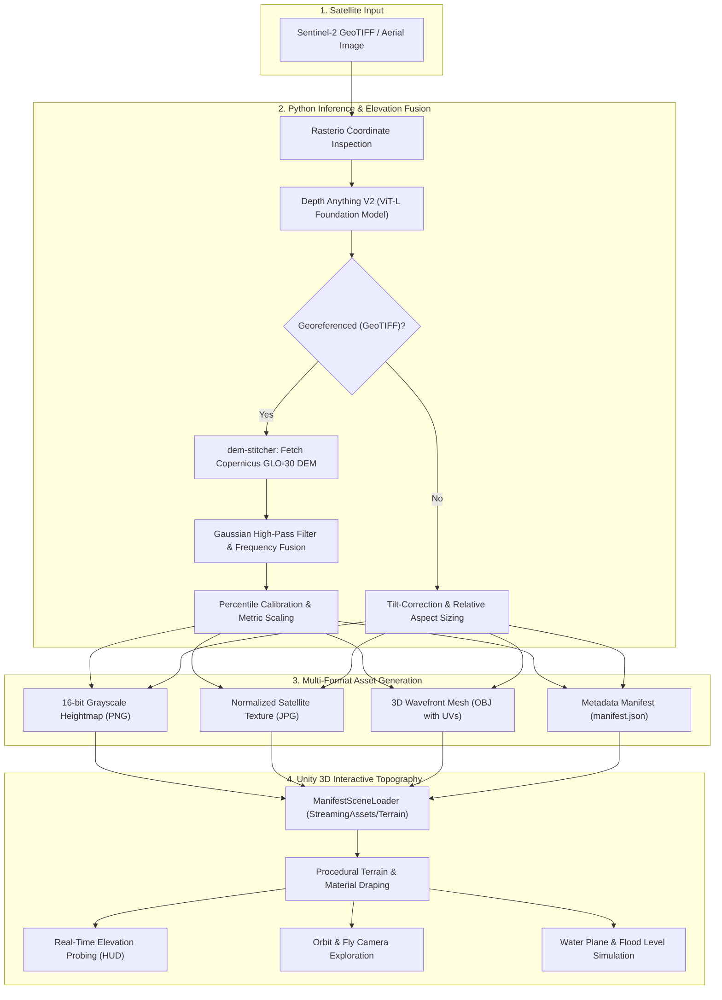

# 🛰️ TerraByte

**AI-Powered Satellite Imagery to 3D Topographic Digital Surface Models & Interactive Unity Visualization**

[](https://www.python.org/)
[](https://pytorch.org/)
[](https://unity.com/)
[](https://unity.com/srp/universal-render-pipeline)
[](https://github.com/DepthAnything/Depth-Anything-V2)
[](https://spacedata.copernicus.eu/)

---

## 📖 Overview

**TerraByte** is an end-to-end geospatial intelligence and visualization platform that converts 2D optical satellite imagery (such as Sentinel-2 multispectral tiles) into metric-calibrated 3D digital surface models (DSMs) and high-fidelity interactive terrain environments in Unity.

By coupling foundation-model monocular depth estimation (**Depth Anything V2 Large / ViT-L**) with global elevation references (**Copernicus GLO-30 / SRTM**) and frequency-domain fusion, TerraByte accurately recovers macro-topography as well as micro-surface relief. The output is directly ingested by an interactive Unity Universal Render Pipeline (URP) digital twin equipped with runtime terrain streaming, real-time elevation probing, dynamic flood simulation, and dual-mode exploration cameras.

---

## 🏗️ System Architecture



---

## ✨ Key Features

### 🧠 Machine Learning & Elevation Pipeline
- **Foundation Model Monocular Depth**: Utilizes `DepthAnythingV2` with a Vision Transformer Large (`vitl`) backbone to predict high-resolution relative depth from 2D optical features.
- **Automated Georeferencing & DEM Stitching**: Automatically reads geospatial metadata and bounding boxes via `rasterio`, transforms coordinates to WGS-84 (`EPSG:4326`), and fetches Copernicus GLO-30 30-meter elevation models using `dem-stitcher`.
- **Frequency-Domain Fusion**:
  - Extracts macro-elevation from regional DEMs.
  - Applies a Gaussian high-pass filter to the AI depth map to isolate micro-topographic details (ridges, cliffs, gullies).
  - Fuses both bands into an absolute metric elevation model.
- **Adaptive Fallback for Non-Georeferenced Imagery**: Supports arbitrary satellite/aerial JPG and PNG images with tilt-correction and proportional real-world footprint estimation.
- **Export Formats**:
  - `heightmap.png`: 16-bit unsigned grayscale heightmap for Unity Terrain engines.
  - `texture.jpg`: Normalized, high-contrast surface texture map.
  - `terrain_mesh.obj`: Fully UV-mapped 3D mesh with vertex heights.
  - `manifest.json`: Metadata specifying elevation ranges, metric widths/heights, and file paths.
- **Validation & Benchmarking**: Dedicated `evaluate.py` module to compute **Mean Absolute Error (MAE)** and **Root Mean Square Error (RMSE)** against ground truth DEMs, generating high-resolution 2D error heatmaps.

### 🎮 Unity 3D Topography Digital Twin
- **Universal Render Pipeline (URP)**: Modern graphics pipeline with custom shaders (`DepthWizardGradientSky`, `DepthWizardWater`).
- **Dynamic Runtime Scene Swapping**: `ManifestSceneLoader` monitors `StreamingAssets/Terrain/` to load and swap scenes without recompilation.
- **Dual Camera Controller**: `OrbitFlyCamera` supports both target orbit inspection and free-flight WASD exploration.
- **Live Elevation Measurement HUD**: `ElevationDisplay` performs continuous raycasting to display exact altitude in meters above sea level at the crosshair position.
- **Interactive Topography Controls**:
  - **Relief Exaggeration Slider**: Dynamically adjust vertical height scale.
  - **Water Plane / Flood Simulation**: Toggle water plane and adjust sea level to inspect flood vulnerabilities.
  - **Scene Switcher Menu**: Quick selection between loaded satellite patches.
- **Editor Tooling**: Custom Unity Editor utilities (`DepthWizardSceneSetup`, `DepthWizardTerrainBuilder`, `DepthWizardTextureDrapeWindow`).

---

## 📁 Repository Structure

```
terrabyte/
├── .gitignore                                 # Git ignore for Unity, PyTorch, and large models
├── README.md                                  # Project documentation
│
├── Sattelite-image-depth-evaluation-model-/   # Python Depth Inference & Evaluation
│   ├── mpipeline.py                           # Master end-to-end elevation & export pipeline
│   ├── evaluate.py                            # Accuracy benchmarking (MAE, RMSE, Error heatmap)
│   ├── requirements.txt                       # Python dependencies
│   ├── checkpoints/                           # Model weights directory (.gitkeep)
│   ├── dataset/                               # Sample Sentinel-2 patches (.tif)
│   ├── depth_anything_v2/                     # Depth Anything V2 architecture & DINOv2 layers
│   ├── metric_depth/                          # Metric depth training and point-cloud tools
│   ├── target/                                # Sample generated output assets
│   └── assets/                                # Visual assets, demos, and media
│
└── topography_unity/                          # Interactive Unity 3D Topography Project
    ├── Assets/
    │   ├── Editor/                            # Custom Editor setup tools & terrain builders
    │   ├── Rendering/                         # URP rendering pipelines & material presets
    │   ├── Scenes/                            # SampleScene.unity main viewport
    │   ├── Scripts/
    │   │   ├── Camera/                        # OrbitFlyCamera.cs
    │   │   ├── Data/                          # Manifest loader, parser, and validator
    │   │   ├── Interaction/                   # ElevationDisplay.cs raycasting HUD
    │   │   ├── Terrain/                       # TerrainBuildUtility.cs
    │   │   └── UI/                            # Scene switcher, height slider, flood controls
    │   ├── Shaders/                           # Water and gradient sky shaders
    │   └── StreamingAssets/
    │       └── Terrain/                       # Scene folders with heightmap, texture, manifest
    ├── Packages/                              # Unity Package Manager manifest & lock
    └── ProjectSettings/                       # URP, Input System, and project settings
```

---

## 🚀 Quick Start Guide

### 1. Prerequisites

- **Python**: Version 3.10 or 3.11 recommended.
- **GPU**: NVIDIA GPU with CUDA support recommended (CPU fallback supported).
- **Unity**: Unity 2022.3 LTS or Unity 6 with Universal Render Pipeline (URP).
- **Git**: Installed and configured.

---

### 2. Python ML Pipeline Setup

1. **Clone the repository**:
   ```bash
   git clone https://github.com/CuriousCorgi-dot/terrabyte.git
   cd terrabyte/Sattelite-image-depth-evaluation-model-
   ```

2. **Create and activate a virtual environment**:
   ```bash
   # Windows (PowerShell)
   python -m venv venv
   .\venv\Scripts\Activate.ps1

   # Linux / macOS
   python3 -m venv venv
   source venv/bin/activate
   ```

3. **Install dependencies**:
   ```bash
   pip install -r requirements.txt
   ```

4. **Download Foundation Model Checkpoint**:
   Download the **Depth-Anything-V2-Large** weights (`depth_anything_v2_vitl.pth`, ~1.3 GB) and place it inside the `checkpoints/` directory:
   - Direct Download: [Depth-Anything-V2-Large Checkpoint (Hugging Face)](https://huggingface.co/depth-anything/Depth-Anything-V2-Large/resolve/main/depth_anything_v2_vitl.pth)
   - Or via curl / wget:
     ```bash
     curl -L -o checkpoints/depth_anything_v2_vitl.pth https://huggingface.co/depth-anything/Depth-Anything-V2-Large/resolve/main/depth_anything_v2_vitl.pth
     ```

---

### 3. Running the Elevation Pipeline

Run `mpipeline.py` on any Sentinel-2 GeoTIFF or standard aerial image:

```bash
# Process a georeferenced Sentinel-2 patch from dataset/
python mpipeline.py dataset/S2A_MSIL2A_20230715T101601_R065_T32TNT_20230715T181708_patch_24.tif
```

**What the pipeline does:**
1. Checks for geospatial CRS & bounding box.
2. Runs ViT-L monocular depth estimation.
3. Downloads the matching Copernicus GLO-30 DEM tile.
4. Fuses high-frequency details with absolute elevations.
5. Directly exports into `topography_unity/Assets/StreamingAssets/Terrain/<scene_id>/`:
   - `heightmap.png`
   - `texture.jpg`
   - `terrain_mesh.obj`
   - `manifest.json`

---

### 4. Evaluating DSM Accuracy

To benchmark predicted elevations against ground truth rasters:

```bash
python evaluate.py
```
- Enter the filename of the predicted DSM.
- Enter the ground-truth DSM filename.
- The tool outputs:
  - **Mean Absolute Error (MAE)** (meters)
  - **Root Mean Square Error (RMSE)** (meters)
  - Saves an error heatmap: `evaluation_heatmap.png`

---

### 5. Running the Unity Topography Viewer

1. Launch **Unity Hub**.
2. Click **Add** -> **Add project from disk** and select the `topography_unity` folder.
3. Open the project in Unity (using 2022.3 LTS or Unity 6).
4. In the Project window, navigate to `Assets/Scenes/` and double-click `SampleScene.unity`.
5. Press **Play** (▶️) at the top of the editor.

#### Navigation & Controls:
| Control | Action |
|---|---|
| **Right Mouse Button + Drag** | Look around (Fly Mode) or Orbit around target (Orbit Mode) |
| **W / A / S / D** | Fly camera forward / left / backward / right |
| **Q / E** | Fly camera down / up |
| **Shift (Hold)** | Boost camera movement speed |
| **Scroll Wheel** | Zoom in / out (Orbit Mode) |
| **HUD Crosshair** | Displays real-time altitude (elevation above sea level) |
| **UI Dropdown** | Switch active terrain scenes loaded from StreamingAssets |
| **Height Slider** | Real-time vertical terrain scale exaggeration |
| **Water Toggle** | Enable/disable water plane for flood inspection |

---

## 📊 Sample Data & Manifest Format

Each generated scene includes a `manifest.json` that bridges the Python pipeline with Unity:

```json
{
    "id": "S2A_MSIL2A_20230715T101601_R065_T32TNT_20230715T181708_patch_24",
    "source_image": "S2A_MSIL2A_20230715T101601_R065_T32TNT_20230715T181708_patch_24.tif",
    "texture": "topography_unity/Assets/StreamingAssets/Terrain/.../texture.jpg",
    "heightmap": "topography_unity/Assets/StreamingAssets/Terrain/.../heightmap.png",
    "heightmap_encoding": "grayscale16",
    "heightmap_width_px": 512,
    "heightmap_height_px": 512,
    "mesh_width_px": 256,
    "mesh_height_px": 256,
    "mesh_subsample_factor": 2,
    "elevation_range_m": {
        "min": 142.50,
        "max": 894.20
    },
    "reference_available": true,
    "real_world_size_m": {
        "width": 5120.00,
        "height": 5120.00
    }
}
```

---

## 🛠️ Tech Stack & Acknowledgments

- **Depth Anything V2**: Foundation monocular depth estimation ([GitHub](https://github.com/DepthAnything/Depth-Anything-V2)).
- **Copernicus GLO-30**: Global 30m Digital Elevation Model ([Copernicus Space Component Data Access](https://spacedata.copernicus.eu/)).
- **dem-stitcher**: Seamless DEM fetching and clipping.
- **Rasterio & GDAL**: Geospatial raster processing.
- **Unity Universal Render Pipeline (URP)**: High-performance real-time 3D rendering.

---

## 📄 License

This project is licensed under the Apache License 2.0. See the [LICENSE](LICENSE) file for details.
